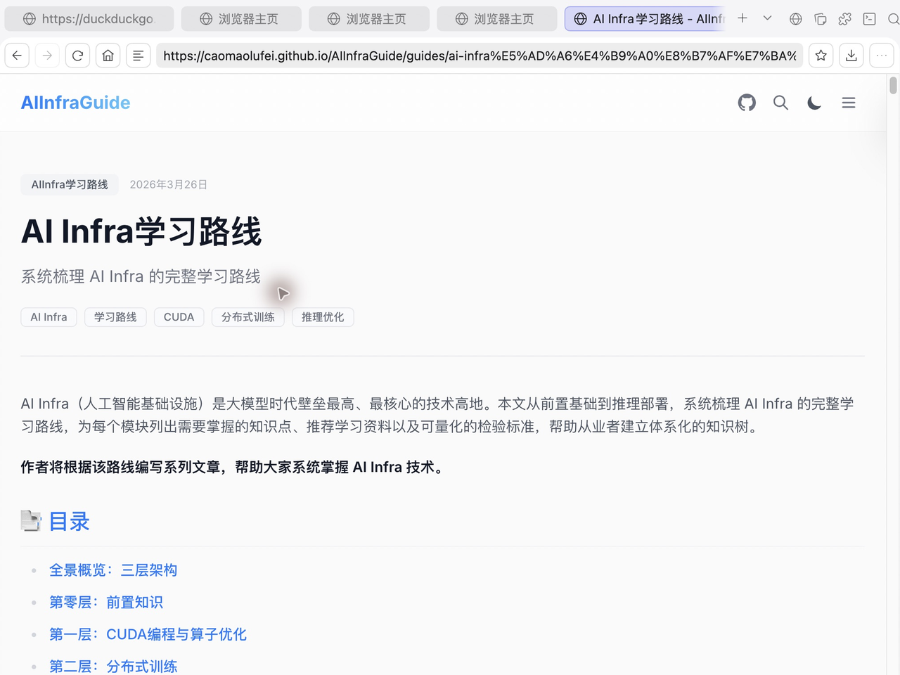
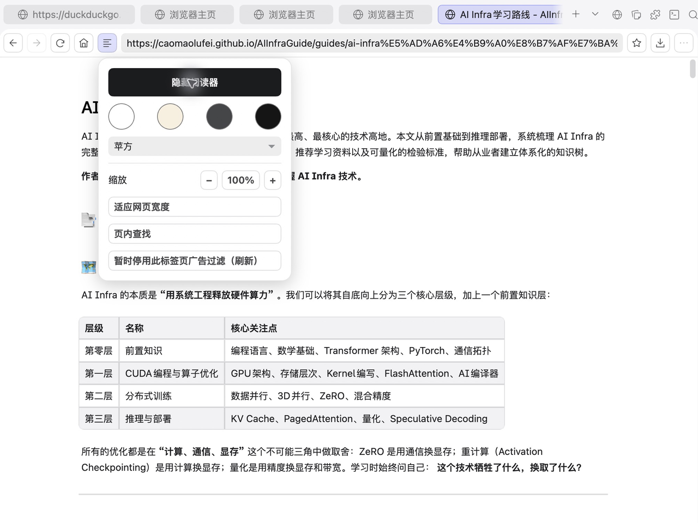
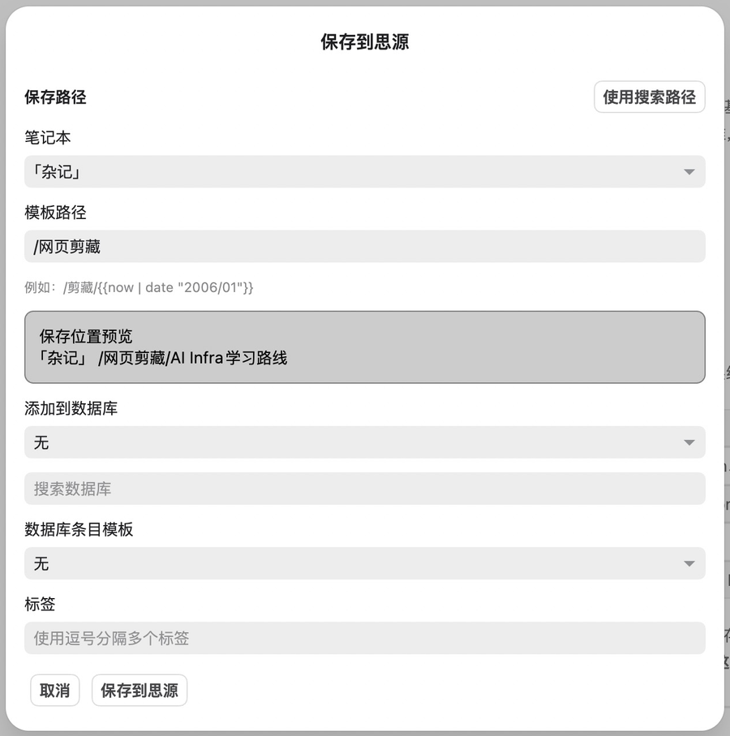
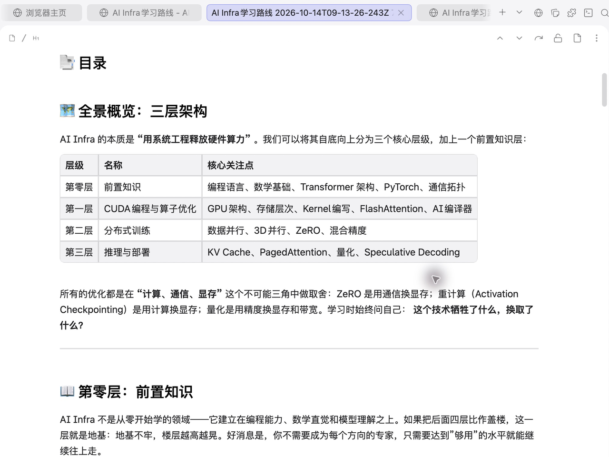
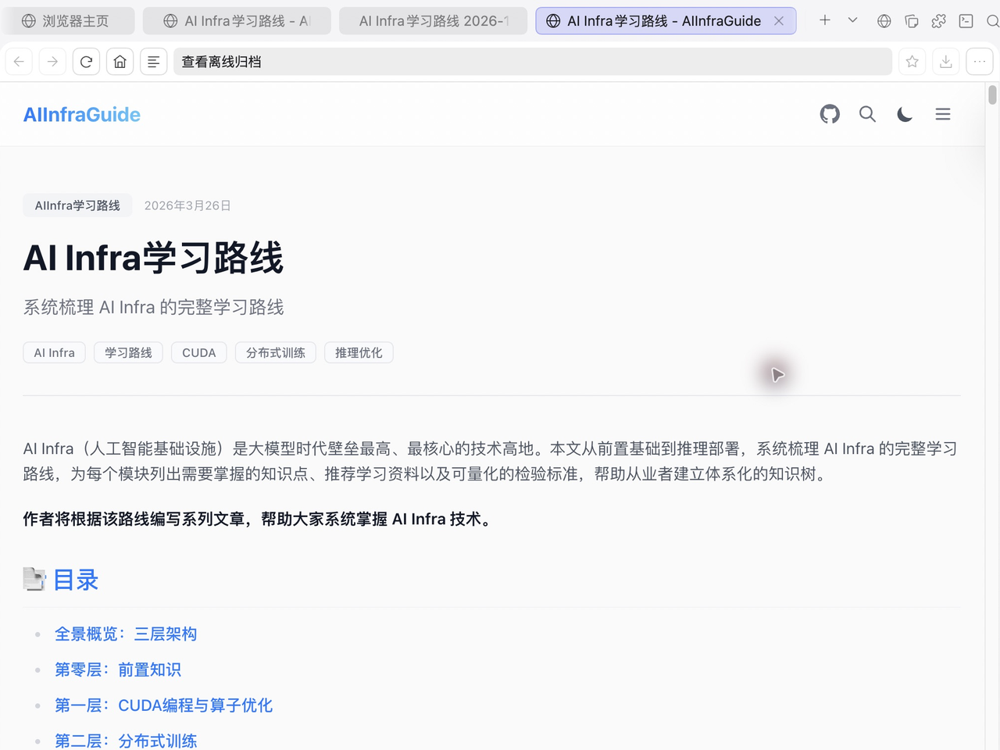

# 思源浏览器

[English](README.md) · **简体中文**

[](https://github.com/fu1fan/siyuan-browser/releases/latest)
[](LICENSE)
[](https://b3log.org/siyuan/)

在思源笔记里浏览、阅读和剪藏网页。从公开资料中提取正文，保存成可编辑的笔记，并保留网页的 MHTML 离线快照。



*本文截图均来自 macOS 上实际运行的思源 3.8.6 与本插件。演示网页为公开的 [AIInfraGuide](https://caomaolufei.github.io/AIInfraGuide/)，截图裁去私人笔记侧栏，只做裁切和缩放。*

## 功能

- **原生标签页**：网页使用思源标签页，可分屏、打开独立窗口；笔记中的 HTTP(S) 外链默认在插件中打开，也可在设置关闭接管。
- **地址与搜索**：输入网址、域名或关键词，检索本地书签、历史和搜索建议；默认 DuckDuckGo，可更换搜索引擎。
- **主页与资料库**：主页展示书签、最常访问、最近关闭和历史，支持隐藏区域与调整顺序；每个区域可就地展开。侧栏资料库列出同样的条目，不再提供独立的书签/历史标签页。
- **专注阅读**：提取正文，选择阅读主题和字体，调整缩放、适应网页宽度和页内查找。
- **网页大纲**：自动从阅读器提取结果整理标题，在思源大纲面板显示层级并支持点击跳转；普通网页与阅读器视图均可使用，切回笔记时恢复笔记大纲。
- **网页剪藏**：选择笔记本、父文档或模板路径，生成新的正文文档，尽力转存可下载资源，并单独保存 MHTML 快照。
- **数据库与标签**：剪藏时可选数据库、数据库条目模板和标签；保存位置可使用 Sprig 日期模板。
- **复制增强**：复制网页或阅读器中的选区，在思源正常粘贴为内容块，支持标题、列表、链接、代码和公式。
- **会话与过滤**：网页 Cookie 使用工作空间专属会话，与思源宿主会话隔离；提供广告过滤订阅、当前标签临时过滤开关及浏览数据清理。

## 安装

需要 **思源 3.8.8 或更新版本的桌面客户端**。插件声明适配 macOS、Windows 和 Linux；本次实际工作流程在 macOS 验证，其他平台的原生验收仍待完成。移动端、网页前端不支持内嵌浏览；远程内核模式提供系统浏览器入口。

**思源集市**：上架后，在「设置 → 集市 → 插件」搜索「思源浏览器」并安装、启用。

**手动安装**：从 [最新 Release](https://github.com/fu1fan/siyuan-browser/releases/latest) 下载 `package.zip`，解压到目标工作空间的 `data/plugins/siyuan-browser/`，再在集市的已下载插件中启用。`plugin.json` 和 `index.js` 应直接位于这个目录，不要再套一层目录。升级前请备份现有插件与配置。

## 开始使用

1. 点击思源顶栏的地球图标打开浏览器，在地址栏输入网址或搜索词。
2. 阅读文章时，点击地址栏左侧的阅读菜单，再选择「显示阅读器」。
3. 点击收藏按钮右侧的「保存到思源」按钮，选择保存位置并确认。
4. 在保存任务中查看正文、离线资源和 MHTML 的结果，打开生成的文档或离线归档。

### 阅读公开资料

阅读菜单集中提供阅读器、主题、字体、缩放、适应宽度、页内查找，以及仅在当前标签页生效的临时广告过滤开关。切换临时过滤会刷新网页，关闭标签页后恢复全局设置。



网页的额外缩放通过阅读菜单或更多菜单调整。100% 跟随思源界面缩放，例如思源 125%、网页 120% 时，有效缩放为 150%。Cmd/Ctrl 加号、减号与 0 仍由思源处理。

### 把网页保存成笔记

可以直接搜索父文档，或填写模板路径，例如 `/剪藏/{{now | date "2006/01"}}`。窗口会预览保存位置；选择数据库条目模板时，位置由模板决定。确认后记住选项，取消不修改配置。



每次主动保存创建一篇新文档，不覆盖以前的剪藏。任务把正文、资源和快照的状态分开显示，部分失败可重试，取消会停止后续阶段；已经开始的网络调用可能完成。重试复用同一任务的文档和成功资源，并检查用户是否编辑过正文；数据库条目模板遇到不确定创建结果时不会自动重复创建。


上图来自一次实际保存：公开文章正文已经成为思源内容块，表格和段落可继续编辑。该页面本次需转存的资源为 0 项，不能据此证明所有网站的图片或视频转存都成功。



正文提取和 Markdown 转换使用 **Defuddle 0.19.4**，包含公式、脚注、表格与代码块规则；优先保留可获取的 LaTeX，必要时从 MathML 转换，不对图片公式做 OCR。解析使用当前已加载页面，不调用第三方内容补抓服务。

### 复制片段与离线回看

在网页或阅读器中选中文字，使用 Cmd/Ctrl+C（或宿主原生右键菜单中的复制），然后在思源正常粘贴。输入框仍使用普通复制，转换失败时回退纯文本。选区复制保留远程图片链接，不下载图片或保存整页快照。

保存任务和剪藏文档提供离线归档入口。MHTML 在独立的禁脚本、禁网络视图中打开，适合保留当时页面外观。



## 常用操作

| 操作 | 入口 |
| --- | --- |
| 打开网页 / 搜索 | 顶栏地球图标、地址栏、笔记外链 |
| 返回主页 | 浏览器工具栏的主页按钮 |
| 阅读 / 字体 / 查找 / 缩放 | 地址栏左侧阅读菜单 |
| 收藏当前页面 | 地址栏右侧星形按钮 |
| 剪藏当前页面 | 收藏按钮右侧「保存到思源」按钮 |
| 书签、历史、恢复关闭页 | 内置主页、侧栏或浏览器更多菜单 |
| 分屏、独立窗口、静音 | 浏览器更多菜单 |
| 修改主页、搜索引擎和过滤订阅 | 插件设置 |

## 数据与隐私

- 书签、历史和保存选项保存在当前工作空间的插件数据中，可能随思源同步；历史按网址保留最近 1000 条，最近关闭最多 50 条。
- 网站登录 Cookie 保存在本机 Electron 的工作空间专属分区，不等同于思源数据同步，换设备后可能需要重新登录。
- 访问网页、搜索建议、网站图标和过滤订阅需要网络请求。Google、Bing、DuckDuckGo 的地址栏建议会向所选服务发送输入关键词；本地书签与历史检索仍可在建议服务不可用时使用。
- 广告过滤默认使用 EasyList / EasyPrivacy，规则缓存为应用级配置，首次下载取决于网络；失败时保留已有可用缓存。
- 清理插件浏览数据只作用于插件会话，不删除思源笔记、资源或书签；历史与书签分别管理。
- 本插件在思源发布服务中禁用，不向发布页面公开浏览记录。

## 常见问题

**为什么某个页面提取不完整？** 剪藏读取当前已加载 DOM。先滚动加载需要的内容；复杂动态页面、付费墙和未展开区域可能无法完整提取。正文为空时回退净化后的页面内容。

**离线快照能代替原网站吗？** 快照不运行脚本、不访问网络，部分动态内容可能缺失。不递归抓取普通外链，不录制流媒体，也不保证登录操作或服务器交互能离线重现。单资源上限 32 MiB，MHTML 上限 256 MiB；blob 资源会报告未转存。

**图片下载失败怎么办？** 在任务窗口查看资源错误并重试。无法保存的嵌入资源会从笔记中移除，避免笔记自动补抓远程地址；正文与快照可能仍然成功。

**为何数据库没有新增条目？** 确认选择了有效数据库与条目模板，按任务错误处理。普通数据库添加失败可重试原文档；模板创建响应不确定时应先检查是否已经创建。

**哪些能力已经验证？** 本次在真实 macOS 思源中检查了公开网页导航、阅读模式与菜单、默认模板路径剪藏、正文文档和 MHTML 打开。数据库模板、完整下载矩阵、Windows/Linux 等尚未完成本次原生验收，详见 [验证记录](docs/VALIDATION.md)。

## 开发与反馈

需要 Node.js 22 或更新版本。

```sh
git clone https://github.com/fu1fan/siyuan-browser.git
cd siyuan-browser
npm ci
npm run typecheck
npm test
npm run build
npm run verify:package
```

产物为 `dist/` 和 `package.zip`。更多实现说明见 [架构](docs/ARCHITECTURE.md)、[功能边界](docs/FEATURES.md) 和 [发布指南](docs/RELEASING.md)，更新内容见 [CHANGELOG](CHANGELOG.md)。

反馈时请附思源和插件版本、操作系统、复现步骤及脱敏日志：[提交 Issue](https://github.com/fu1fan/siyuan-browser/issues)。

## 致谢与协议

感谢 [思源笔记](https://github.com/siyuan-note/siyuan)提供宿主 API，[Defuddle](https://github.com/kepano/defuddle)提供正文提取与 Markdown 转换，[DOMPurify](https://github.com/cure53/DOMPurify)提供净化能力，以及 [Ghostery adblocker](https://github.com/ghostery/adblocker)提供过滤引擎。文档组织参考本地已安装的思源 Codex、导入工具和浏览器插件，示例页面来自 [AIInfraGuide](https://github.com/caomaolufei/AIInfraGuide)。

本项目采用 [MIT 协议](LICENSE)，第三方依赖保留各自协议，见 [THIRD_PARTY_NOTICES](THIRD_PARTY_NOTICES.md)。这是独立社区插件。
